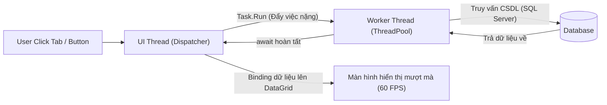
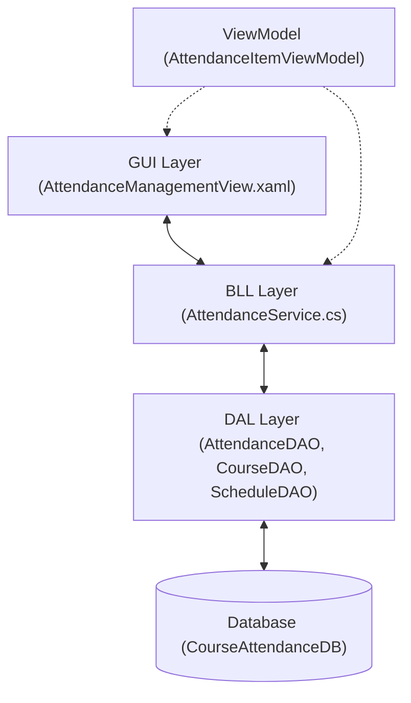

# TÀI LIỆU CHUYÊN SÂU: LÀM CHỦ C# CONSOLE (ASM1) & ỨNG DỤNG WPF 4-TRONG-1 (APPMANAGER)

> **Mục tiêu**: Phân tích tường tận từ nguyên lý CLR, luồng dữ liệu, giải thuật, cấu trúc thiết kế đến cú pháp chi tiết từng dòng code của cả 2 bài toán PRN212, giúp bạn nắm vững bản chất kỹ thuật để tự tin bảo vệ bài và làm chủ môn học.

---

## MỤC LỤC TỔNG QUAN

1. [PHẦN 1: NỀN TẢNG KIẾN TRÚC .NET 8, C# VÀ WPF](#phần-1-nền-tảng-kiến-trúc-net-8-c-và-wpf)
2. [PHẦN 2: BÓC TÁCH TOÀN DIỆN BÀI TẬP ASM1 (CONSOLE APP & DELEGATE)](#phần-2-bóc-tách-toàn-diện-bài-tập-asm1-console-app--delegate)
   - [2.1. Bản chất Delegate và bài toán tính lương `SalaryCaculation`](#21-bản-chất-delegate-và-bài-toán-tính-lương-salarycaculation)
   - [2.2. Phân tích từng dòng code `Employee.cs`](#22-phân-tích-từng-dòng-code-employeecs)
   - [2.3. Phân tích `SalaryCaculation.cs` & `SalaryCalculator`](#23-phân-tích-salarycaculationcs--salarycalculator)
   - [2.4. Phân tích `EmployeeList.cs` (File I/O & LINQ)](#24-phân-tích-employeelistcs-file-io--linq)
   - [2.5. Phân tích `Program.cs` (Luồng điều khiển Menu)](#25-phân-tích-programcs-luồng-điều-khiển-menu)
3. [PHẦN 3: BÓC TÁCH TOÀN DIỆN ỨNG DỤNG WPF 4-TRONG-1 (`AppManager`)](#phần-3-bóc-tách-toàn-diện-ứng-dụng-wpf-4-trong-1-appmanager)
   - [3.1. Kiến trúc Shell Container & Tab Navigation](#31-kiến-trúc-shell-container--tab-navigation)
   - [3.2. Màn hình 1: Đăng ký sinh viên (`StudentRegistrationView`)](#32-màn-hình-1-đăng-ký-sinh-viên-studentregistrationview)
   - [3.3. Màn hình 2: Quản lý sinh viên CSDL SE1963 qua ADO.NET (`StudentManagementView`)](#33-màn-hình-2-quản-lý-sinh-viên-csdl-se1963-qua-adonet-studentmanagementview)
   - [3.4. Màn hình 3: Quản lý nhân viên với Entity Framework Core 8 (`EmployeeManagementView`)](#34-màn-hình-3-quản-lý-nhân-viên-với-entity-framework-core-8-employeemanagementview)
   - [3.5. Màn hình 4: Điểm danh sinh viên kiến trúc 3 lớp (`AttendanceManagementView`)](#35-màn-hình-4-điểm-danh-sinh-viên-kiến-trúc-3-lớp-attendancemanagementview)
   - [3.6. Cơ chế nạp cấu hình đa cơ sở dữ liệu qua `appsettings.json`](#36-cơ-chế-nạp-cấu-hình-đa-cơ-sở-dữ-liệu-qua-appsettingsjson)
4. [PHẦN 4: TỔNG KẾT VÀ BẢNG SO SÁNH CÁC NGUYÊN LÝ CỐT LÕI](#phần-4-tổng-kết-và-bảng-so-sánh-các-nguyên-lý-cốt-lõi)

---

# PHẦN 1: NỀN TẢNG KIẾN TRÚC .NET 8, C# VÀ WPF

### 1. Luồng thực thi mã lệnh trong .NET (CLR & JIT)
* Khi bạn biên dịch dự án (`dotnet build`), mã nguồn C# không được dịch thẳng sang mã máy (Machine Code) mà được dịch sang mã trung gian **IL (Intermediate Language)** đóng gói trong các tệp `.dll`.
* Khi ứng dụng khởi chạy, **CLR (Common Language Runtime)** nạp assembly và trình biên dịch **JIT (Just-In-Time)** sẽ chuyển đổi các khối mã IL này thành mã máy nhị phân tương ứng với vi xử lý hiện hành.

### 2. Mô hình tuyến luồng (Threading Model) và luồng giao diện UI trong WPF
WPF hoạt động trên 2 luồng cốt lõi:
1. **Render Thread**: Luồng chạy ngầm của DirectX chịu trách nhiệm vẽ các pixel lên màn hình.
2. **UI Thread (Dispatcher Thread)**: Chịu trách nhiệm nhận sự kiện (click chuột, gõ phím), xử lý layout và thực thi code-behind.
> [!CAUTION]
> **Quy tắc bất biến trong WPF**: Nếu bạn thực thi một tác vụ tốn thời gian (truy vấn CSDL, đọc file lớn, chờ timeout kết nối mạng) trực tiếp trên **UI Thread**, giao diện sẽ bị **đơ cứng (Not Responding)**. Đó chính là lý do chúng ta phải sử dụng `async / await` và `Task.Run` để đẩy việc nặng sang **Worker Thread (ThreadPool)**.



---

# PHẦN 2: BÓC TÁCH TOÀN DIỆN BÀI TẬP ASM1 (CONSOLE APP & DELEGATE)

## 2.1. Bản chất Delegate và bài toán tính lương `SalaryCaculation`

### Delegate là gì?
Delegate là một **kiểu tham chiếu an toàn kiểu (Type-safe Function Pointer)** trỏ đến một hoặc nhiều hàm có cùng chữ ký (Signature - tức là cùng kiểu trả về và danh sách tham số).

Trong bài toán:
```csharp
public delegate double SalaryCaculation(double salary, string position);
```
* **Bản chất dưới gầm CLR**: Trình biên dịch C# tự động sinh ra một class `SalaryCaculation` kế thừa từ `System.MulticastDelegate`.
* Chữ ký bắt buộc:
  * Nhận vào: `double salary` (lương tháng) và `string position` (chức vụ).
  * Trả về: `double` (lương cả năm).
* **Tại sao phải dùng Delegate ở đây?**
  * Tách rời logic hiển thị (`Display`) của đối tượng `Employee` khỏi thuật toán tính toán lương (`CalculateYearlySalary`).
  * Sau này doanh nghiệp đổi công thức tính lương theo năm cho từng chức vụ, ta chỉ cần viết thêm hàm mới rồi gán vào Delegate mà **không cần sửa một dòng code nào trong class `Employee`** (Tuân thủ nguyên lý *Open/Closed Principle* của SOLID).

---

## 2.2. Phân tích từng dòng code `Employee.cs`

File: [`SE2051\ASM1\Employee.cs`](file:///C:/Users/admin/OneDrive%20-%20MOI,%20Inc/Documents/Tai%20lieu%20hoc%20tap/PRN212/SE2051%20(1)/SE2051/ASM1/Employee.cs)

```csharp
namespace ASM1
{
    public class Employee
    {
        // 1. Mảng hằng số chứa danh sách vị trí hợp lệ
        public static readonly string[] Positions = { "Manager", "Developer", "Tester" };

        // 2. Các thuộc tính tự động (Auto-implemented Properties)
        public int Id { get; set; }
        public string Name { get; set; }     
        public double Salary { get; set; }     
        public string Position { get; set; }   

        // 3. Constructor không tham số (Default Constructor)
        public Employee()
        {
            Name = "";
            Position = "";
        }

        // 4. Constructor có tham số (Parameterized Constructor)
        public Employee(int id, string name, double salary, string position)
        {
            Id = id;
            Name = name;
            Salary = salary;
            Position = position;
        }
```

#### Phân tích chi tiết:
* `public static readonly string[] Positions`:
  * `static`: Thuộc về lớp `Employee`, không cấp phát lại mỗi khi tạo một đối tượng mới, tiết kiệm bộ nhớ.
  * `readonly`: Không thể gán lại mảng mới sau khi khởi tạo, đảm bảo tính bất biến của danh mục chức vụ.
* `public int Id { get; set; }`: Cú pháp Auto-Property. Trình biên dịch tự động tạo một trường ẩn `private int <Id>k__BackingField;`. Cung cấp khả năng đóng gói (Encapsulation) mà không cần viết mã cồng kềnh.
* `public Employee()`: Khởi tạo giá trị chuỗi mặc định là `""` thay vì để `null`, giúp tránh lỗi `NullReferenceException` khi gọi các hàm xử lý chuỗi sau này.

---

### Phương thức nhập dữ liệu `Input()`:

```csharp
        public void Input()
        {
            Id = ReadInt("Input Id: ");

            Console.Write("Input Name: ");
            Name = (Console.ReadLine() ?? "").Trim();

            Salary = ReadDouble("Input Salary (per month): ");

            while (true)
            {
                Console.Write("Input Position (Manager/Developer/Tester): ");
                string p = (Console.ReadLine() ?? "").Trim();
                string? match = Array.Find(Positions, x => x.Equals(p, StringComparison.OrdinalIgnoreCase));
                if (match != null)
                {
                    Position = match;
                    break;
                }
                Console.WriteLine("Invalid position!");
            }
        }
```

#### Kỹ thuật lập trình quan trọng:
1. `(Console.ReadLine() ?? "").Trim()`:
   * Toán tử `??` (Null-coalescing): Nếu người dùng nhấn Enter mà trả về `null`, tự động gán chuỗi rỗng `""`.
   * `.Trim()`: Cắt bỏ khoảng trắng thừa ở hai đầu chuỗi.
2. `Array.Find(Positions, x => x.Equals(p, StringComparison.OrdinalIgnoreCase))`:
   * Sử dụng biểu thức Lambda `x => ...` làm predicate để tìm kiếm phần tử trong mảng.
   * `StringComparison.OrdinalIgnoreCase`: So sánh nhị phân từng ký tự không phân biệt hoa thường (ví dụ: `developer`, `DEVELOPER`, `Developer` đều được chấp nhận).
3. Vòng lặp `while(true)`: Ép người dùng nhập đúng chức vụ trong danh mục cho phép mới cho qua (`break`).

---

### Phương thức hiển thị với Delegate `Display()`:

```csharp
        public void Display(SalaryCaculation delObj)
        {
            Console.WriteLine($"Id: {Id} - Name: {Name} - Position: {Position}");
            Console.WriteLine($"Monthly salary: {Salary:N0}");
            Console.WriteLine($"Yearly salary : {delObj(Salary, Position):N0}");
        }
```

#### Phân tích chi tiết:
* `Display(SalaryCaculation delObj)`: Phương thức nhận một Delegate `delObj` làm đối số.
* `delObj(Salary, Position)`: Lời gọi hàm gián tiếp thông qua delegate. Ta truyền vào lương tháng `Salary` và chức vụ `Position` của nhân viên hiện tại.
* Định dạng `{Salary:N0}`:
  * `N`: Định dạng số có dấu phân cách hàng nghìn (Number format).
  * `0`: Lấy 0 chữ số thập phân (ví dụ: `1,000,000`).

---

### Các hàm hỗ trợ nhập dữ liệu an toàn `ReadInt` và `ReadDouble`:

```csharp
        private static int ReadInt(string msg)
        {
            while (true)
            {
                Console.Write(msg);
                if (int.TryParse(Console.ReadLine(), out int v)) return v;
                Console.WriteLine("Wrong format! Please input an integer.");
            }
        }
```

#### Nguyên lý chống sập chương trình:
* **Không bao giờ dùng `int.Parse(Console.ReadLine())`** vì nếu người dùng gõ chữ cái hoặc ký tự đặc biệt, chương trình sẽ ném ra ngoại lệ `FormatException` và lập tức dừng chương trình.
* **`int.TryParse(string, out int)`**: Trả về `true` nếu ép kiểu thành công và đẩy kết quả vào biến `v` thông qua từ khóa `out`; trả về `false` nếu thất bại mà không làm văng app. Kết hợp vòng lặp `while(true)` tạo thành cấu trúc nhập liệu phòng thủ hoàn hảo.

---

## 2.3. Phân tích `SalaryCaculation.cs` & `SalaryCalculator`

File: [`SE2051\ASM1\SalaryCaculation.cs`](file:///C:/Users/admin/OneDrive%20-%20MOI,%20Inc/Documents/Tai%20lieu%20hoc%20tap/PRN212/SE2051%20(1)/SE2051/ASM1/SalaryCaculation.cs)

```csharp
namespace ASM1
{
    public delegate double SalaryCaculation(double salary, string position);

    public static class SalaryCalculator
    {
        public static double CalculateYearlySalary(double salary, string position)
        {
            double yearly = salary * 12;
            if(position.Equals("Manager", StringComparison.OrdinalIgnoreCase))
            {
                yearly *= 1.5;
            }
            else if (position.Equals("Developer", StringComparison.OrdinalIgnoreCase))
            {
                yearly *= 1.3;
            }
            else if (position.Equals("Tester", StringComparison.OrdinalIgnoreCase))
            {
                yearly *= 1.2;
            }
            return yearly;  
        }
    }
}
```

* `public static class SalaryCalculator`: Lớp tĩnh chứa hàm tiện ích, không cần khởi tạo đối tượng bằng từ khóa `new`.
* Chữ ký của `CalculateYearlySalary`: Nhận `(double, string)`, trả về `double` $\rightarrow$ **Khớp 100% với chữ ký của delegate `SalaryCaculation`**.
* Nhờ đó, hàm này có thể được truyền trực tiếp vào tham số delegate: `emp.Display(SalaryCalculator.CalculateYearlySalary);` (Kỹ thuật **Method Group Conversion**).

---

## 2.4. Phân tích `EmployeeList.cs` (File I/O & LINQ)

File: [`SE2051\ASM1\EmployeeList.cs`](file:///C:/Users/admin/OneDrive%20-%20MOI,%20Inc/Documents/Tai%20lieu%20hoc%20tap/PRN212/SE2051%20(1)/SE2051/ASM1/EmployeeList.cs)

### 1. Thuật toán đọc file định dạng `id|name|salary|position`:

```csharp
        public void inputEmployeeFromFile(string filePath)
        {
            if (!File.Exists(filePath))
            {
                Console.WriteLine($"File not found at path: {filePath}");
                return;
            }

            string[] lines = File.ReadAllLines(filePath);
            foreach (string rawLine in lines)
            {
                string line = rawLine.Trim();
                if (string.IsNullOrEmpty(line)) continue;

                string[] parts = line.Split('|');
                if (parts.Length == 4)
                {
                    if (int.TryParse(parts[0].Trim(), out int id) &&
                        double.TryParse(parts[2].Trim(), out double salary))
                    {
                        Employee e = new Employee
                        {
                            Id = id,
                            Name = parts[1].Trim(),
                            Salary = salary,
                            Position = parts[3].Trim()
                        };
                        AddEmployee(e);
                    }
                }
            }
        }
```

#### Luồng hoạt động chi tiết:
1. `File.Exists(filePath)`: Kiểm tra xem tệp có tồn tại trên đĩa không trước khi đọc. Tránh lỗi `FileNotFoundException`.
2. `File.ReadAllLines(filePath)`: Đọc toàn bộ nội dung file và trả về một mảng `string[]`, mỗi phần tử tương ứng 1 dòng text.
3. `line.Split('|')`: Băm dòng text theo ký tự phân cách `|`.
   * Ví dụ dòng: `"1|Hung|1000|Manager"` $\rightarrow$ mảng 4 phần tử: `parts[0] = "1"`, `parts[1] = "Hung"`, `parts[2] = "1000"`, `parts[3] = "Manager"`.
4. Khởi tạo đối tượng `Employee` bằng cú pháp **Object Initializer** `{ Id = id, ... }` và thêm vào danh sách quản lý `employees.Add(e)`.

---

### 2. Các phương thức tìm kiếm nâng cao bằng LINQ:

#### A. Tìm kiếm theo Id (Khóa chính):
```csharp
        public void searchEmployeeById(int id)
        {
            var foundEmployee = employees.FirstOrDefault(e => e.Id == id);
            if (foundEmployee != null)
            {
                foundEmployee.Display(SalaryCalculator.CalculateYearlySalary);
            }
            else
            {
                Console.WriteLine($"No employee found with ID '{id}'.");
            }
        }
```
* `FirstOrDefault(predicate)`: Dò qua danh sách, trả về phần tử đầu tiên thỏa mãn điều kiện `e.Id == id`. Nếu không có phần tử nào khớp, trả về giá trị mặc định của kiểu tham chiếu là `null`.

#### B. Tìm kiếm theo Name và Position:
```csharp
        public void searchEmployeeByName(string name)
        {
            var foundEmployees = employees
                .Where(e => e.Name.Equals(name, StringComparison.OrdinalIgnoreCase))
                .ToList();
            // In danh sách tìm thấy
        }
```
* `Where(...)`: Trả về một tập hợp lọc lười (`IEnumerable<T>`). Gọi `.ToList()` để thực thi câu truy vấn ngay lập tức và đưa vào danh sách mới.

#### C. Tìm kiếm theo khoảng Lương Năm (Kết hợp LINQ & Delegate):
```csharp
        public void searchEmployeeByYearlySalaryInRange(double minYearlySalary, double maxYearlySalary)
        {
            var foundEmployees = employees.Where(e =>
            {
                double yearlySalary = SalaryCalculator.CalculateYearlySalary(e.Salary, e.Position);
                return yearlySalary >= minYearlySalary && yearlySalary <= maxYearlySalary;
            }).ToList();
            ...
        }
```
* Đây là điểm mấu chốt của đề bài: Trong biểu thức Lambda của LINQ, ta gọi hàm `CalculateYearlySalary(e.Salary, e.Position)` để tính lương năm thực tế của nhân viên trước khi so sánh với khoảng `[minYearlySalary, maxYearlySalary]`.

---

# PHẦN 3: BÓC TÁCH TOÀN DIỆN ỨNG DỤNG WPF 4-TRONG-1 (`AppManager`)

## 3.1. Kiến trúc Shell Container & Tab Navigation

Ứng dụng `AppManager` được thiết kế theo mô hình **Single-Window Multiple-Views (Một cửa sổ chính chứa nhiều View con)**.

### Sơ đồ cấu trúc giao diện:
```text
┌─────────────────────────────────────────────────────────────────────────────┐
│ MainWindow.xaml (Cửa sổ Host điều phối)                                     │
├─────────────────────────────────────────────────────────────────────────────┤
│ [TopTabBtn 1: Đăng ký SV]  [TopTabBtn 2: Quản lý SV]  [Btn 3]  [Btn 4]      │
├─────────────────────────────────────────────────────────────────────────────┤
│ <ContentControl x:Name="mainContent"/>                                      │
│                                                                             │
│   ┌─────────────────────────────────────────────────────────────────────┐   │
│   │  Tùy theo nút được bấm, vùng này sẽ nạp:                            │   │
│   │  - StudentRegistrationView (UserControl 1)                          │   │
│   │  - StudentManagementView   (UserControl 2)                          │   │
│   │  - EmployeeManagementView  (UserControl 3)                          │   │
│   │  - AttendanceManagementView(UserControl 4)                          │   │
│   └─────────────────────────────────────────────────────────────────────┘   │
└─────────────────────────────────────────────────────────────────────────────┘
```

### Mã điều hướng chuyển Tab cực nhanh (0ms, không lag):
```csharp
private readonly StudentRegistrationView _studentRegView = new();
private readonly StudentManagementView _studentMgmtView = new();
private readonly EmployeeManagementView _employeeView = new();
private readonly AttendanceManagementView _attendanceView = new();

private void SwitchTab(int tabIndex)
{
    // 1. Tắt trạng thái Active của toàn bộ nút tab
    btnTab1.Tag = null;
    btnTab2.Tag = null;
    btnTab3.Tag = null;
    btnTab4.Tag = null;

    // 2. Kích hoạt nút tab tương ứng và hoán đổi nội dung
    switch (tabIndex)
    {
        case 1:
            btnTab1.Tag = "Active";
            mainContent.Content = _studentRegView;
            break;
        case 2:
            btnTab2.Tag = "Active";
            mainContent.Content = _studentMgmtView;
            break;
        case 3:
            btnTab3.Tag = "Active";
            mainContent.Content = _employeeView;
            break;
        case 4:
            btnTab4.Tag = "Active";
            mainContent.Content = _attendanceView;
            break;
    }
}
```

> [!TIP]
> **Bí quyết chống lag**: 4 đối tượng View được khởi tạo sẵn trong bộ nhớ một lần duy nhất (`private readonly ... = new()`). Khi chuyển tab, ta chỉ gán lại thuộc tính `mainContent.Content = activeView`. Giao diện tráo đổi con trỏ visual tức thì mà không phải parse lại XAML hay khởi tạo lại các control.

---

## 3.2. Màn hình 1: Đăng ký sinh viên (`StudentRegistrationView`)

File: [`AppManager\Views\StudentRegistrationView.xaml`](file:///C:/Users/admin/OneDrive%20-%20MOI,%20Inc/Documents/Tai%20lieu%20hoc%20tap/PRN212/SE2051%20(1)/SE2051/AppManager/Views/StudentRegistrationView.xaml)

### 1. Phân tích cú pháp XAML quan trọng:

#### A. Cặp Slider và TextBlock hiển thị giá trị thời gian thực:
```xml
<Slider x:Name="sliderMucDo" Minimum="0" Maximum="100" Value="50" 
        IsSnapToTickEnabled="True" TickFrequency="1" VerticalAlignment="Center"/>

<TextBlock Grid.Column="1" 
           Text="{Binding ElementName=sliderMucDo, Path=Value}" 
           FontWeight="Bold" Foreground="#2563EB"/>
```
* **Element Data Binding**: Dùng `{Binding ElementName=sliderMucDo, Path=Value}` để TextBlock tự động lắng nghe sự kiện thay đổi thuộc tính `Value` của thanh trượt Slider mà **không cần viết bất kỳ một dòng code C# nào** trong code-behind.

#### B. RadioButton phân nhóm:
```xml
<RadioButton x:Name="rbNam" Content="Nam" Margin="0,0,30,0"/>
<RadioButton x:Name="rbNu" Content="Nữ"/>
```
* Vì cả 2 RadioButton cùng nằm trong một `StackPanel` cha, WPF tự động gom chúng thành 1 nhóm loại trừ nhau (chọn Nam thì Nữ tự bỏ chọn và ngược lại).

### 2. Xử lý logic nghiệp vụ trong Code-Behind:
```csharp
private void btnDangKy_Click(object sender, RoutedEventArgs e)
{
    // Kiểm tra rỗng
    string hoTen = txtHoTen.Text.Trim();
    if (string.IsNullOrEmpty(hoTen)) { ... return; }

    // Đọc DatePicker (Dạng Nullable DateTime)
    if (!dpNgaySinh.SelectedDate.HasValue) { ... return; }
    string ngaySinh = dpNgaySinh.SelectedDate.Value.ToString("dd/MM/yyyy");

    // Đọc ComboBox
    string khoa = (cbKhoa.SelectedItem as ComboBoxItem)?.Content.ToString() ?? cbKhoa.Text;

    // Đọc danh sách CheckBox
    List<string> listSoThich = new List<string>();
    if (chkLapTrinh.IsChecked == true) listSoThich.Add("Lập trình");
    if (chkDocSach.IsChecked == true) listSoThich.Add("Đọc sách");
    if (chkTheThao.IsChecked == true) listSoThich.Add("Thể thao");

    // Hiển thị khung kết quả
    borderResult.Visibility = Visibility.Visible;
}
```

---

## 3.3. Màn hình 2: Quản lý sinh viên CSDL SE1963 qua ADO.NET (`StudentManagementView`)

Màn hình này bám sát bài giảng của thầy trên lớp, sử dụng thư viện **ADO.NET thuần (`System.Data.SqlClient`)** kết nối tới CSDL `SE1963` bảng `STUDENTS`.

### 1. Kiến trúc lớp dữ liệu `DAO.cs`:
File: [`AppManager\DAL\CourseStudent\DAO.cs`](file:///C:/Users/admin/OneDrive%20-%20MOI,%20Inc/Documents/Tai%20lieu%20hoc%20tap/PRN212/SE2051%20(1)/SE2051/AppManager/DAL/CourseStudent/DAO.cs)

```csharp
public static SqlConnection GetConnection()
{
    string conn = "server=.\\SQLEXPRESS;database=SE1963;Trusted_Connection=True;TrustServerCertificate=True;Connect Timeout=3";
    try
    {
        var builder = new ConfigurationBuilder()
            .SetBasePath(AppDomain.CurrentDomain.BaseDirectory)
            .AddJsonFile("appsettings.json", optional: true);
        var config = builder.Build();
        string? cfgConn = config.GetConnectionString("CourseStudentConnection");
        if (!string.IsNullOrEmpty(cfgConn)) conn = cfgConn;
    }
    catch { }
    return new SqlConnection(conn);
}
```

#### Phân tích từng tham số trong Connection String:
* `server=.\SQLEXPRESS`: Trỏ tới SQL Server Instance cục bộ trên máy tính của bạn.
* `database=SE1963`: Tên cơ sở dữ liệu lưu thông tin sinh viên.
* `Trusted_Connection=True`: Sử dụng tài khoản đăng nhập Windows (`Integrated Security = SSPI`), không cần cấu hình `user=sa;password=123`.
* `TrustServerCertificate=True`: Bỏ qua kiểm tra chứng chỉ SSL tự ký của SQL Server, tránh lỗi bắt tay mã hóa.
* `Connect Timeout=3`: **Cực kỳ quan trọng!** Giới hạn thời gian kết nối tối đa là 3 giây. Nếu máy chủ tắt hoặc lỗi, nó sẽ ngắt ngay thay vì treo đứng giao diện 30 giây.

---

### 2. Phương thức truy vấn dữ liệu `GetDataBySql` và chống SQL Injection:
```csharp
public static DataTable GetDataBySql(string sql, SqlParameter[]? parameters = null)
{
    using var conn = GetConnection();
    using var cmd = new SqlCommand(sql, conn);
    if (parameters != null) cmd.Parameters.AddRange(parameters);
    using var adapter = new SqlDataAdapter(cmd);
    var dt = new DataTable();
    adapter.Fill(dt);
    return dt;
}
```

#### Bản chất kỹ thuật:
* `using var conn = ...`: Cơ chế **using declaration** của C# 8+. Đối tượng `conn` sẽ tự động đóng kết nối (`conn.Close()`) và giải phóng tài nguyên unmanaged (`conn.Dispose()`) ngay khi hàm kết thúc, chống rò rỉ kết nối (Connection Leak).
* `SqlParameter`: Tham số hóa câu lệnh truy vấn (Parameterized Query). Ngăn chặn hoàn toàn lỗ hổng bảo mật **SQL Injection**.
* `SqlDataAdapter.Fill(dt)`: Mở kết nối, thực thi câu lệnh SQL `SELECT`, đổ toàn bộ các dòng dữ liệu vào bộ nhớ ảo `DataTable`, sau đó tự động đóng kết nối.

---

### 3. Tối ưu hóa bất đồng bộ trong `StudentManagementView.xaml.cs`:
File: [`AppManager\Views\StudentManagementView.xaml.cs`](file:///C:/Users/admin/OneDrive%20-%20MOI,%20Inc/Documents/Tai%20lieu%20hoc%20tap/PRN212/SE2051%20(1)/SE2051/AppManager/Views/StudentManagementView.xaml.cs)

```csharp
private bool _isLoaded = false;

private async void UserControl_Loaded(object sender, RoutedEventArgs e)
{
    if (!_isLoaded)
    {
        await LoadDataAsync();
    }
}

public async Task LoadDataAsync()
{
    try
    {
        var list = await Task.Run(() => StudentDAO.getAllStudent());
        grid1.ItemsSource = list;
        _isLoaded = true;
    }
    catch (Exception ex)
    {
        MessageBox.Show($"Lỗi kết nối CSDL SE1963: {ex.Message}", "Lỗi CSDL", MessageBoxButton.OK, MessageBoxImage.Warning);
    }
}
```

#### Phân tích nguyên lý `async / await` & `Task.Run`:
1. `Task.Run(() => StudentDAO.getAllStudent())`: Đẩy việc mở socket mạng và truy vấn bảng `STUDENTS` sang một luồng Worker trong ThreadPool chạy ngầm.
2. Từ khóa `await`: Tạm thời giải phóng luồng chính UI Thread để ứng dụng tiếp tục vẽ giao diện và nhận lệnh click chuột của người dùng.
3. Khi `Task` hoàn thành: CLR tự động quay trở lại luồng UI để thực hiện lệnh gán dữ liệu `grid1.ItemsSource = list;`.
4. Cờ `_isLoaded = true`: Đảm bảo khi người dùng click qua tab khác rồi click quay lại, app không tốn thời gian truy vấn lại nếu dữ liệu đã có.

---

## 3.4. Màn hình 3: Quản lý nhân viên với Entity Framework Core 8 (`EmployeeManagementView`)

Màn hình này sử dụng **Entity Framework Core 8** (ORM hiện đại nhất của Microsoft).

### 1. Phân tích `EmployeeDbContext.cs`:
File: [`AppManager\Data\Employee\AppDbContext.cs`](file:///C:/Users/admin/OneDrive%20-%20MOI,%20Inc/Documents/Tai%20lieu%20hoc%20tap/PRN212/SE2051%20(1)/SE2051/AppManager/Data/Employee/AppDbContext.cs)

```csharp
public class AppDbContext : DbContext
{
    public DbSet<Department> Departments => Set<Department>();
    public DbSet<Employee> Employees => Set<Employee>();
```
* `DbSet<T>`: Đại diện cho một bảng trong CSDL tương ứng với Entity class `T`.
* Cấu hình quan hệ Một - Nhiều (1-N) bằng Fluent API:
```csharp
entity.HasOne(e => e.Department)
      .WithMany(d => d.Employees)
      .HasForeignKey(e => e.DepartmentId)
      .OnDelete(DeleteBehavior.Restrict);
```
  * Một nhân viên (`Employee`) thuộc về một phòng ban (`HasOne(e => e.Department)`).
  * Một phòng ban có nhiều nhân viên (`WithMany(d => d.Employees)`).
  * Khóa ngoại là `DepartmentId`.
  * `OnDelete(DeleteBehavior.Restrict)`: Ngăn chặn xóa phòng ban nếu phòng ban đó đang có nhân viên trực thuộc.

---

### 2. Thuật toán tự động suy luận giới tính (`InferGender`):
```csharp
public static string InferGender(string? firstName, string? middleName, string? lastName)
{
    string mid = (middleName ?? "").Trim().ToLower();
    string first = (firstName ?? "").Trim().ToLower();

    // Quy tắc tiếng Việt
    if (mid.Contains("thị") || mid.Contains("thi"))
        return "Female";

    if (mid.Contains("văn") || mid.Contains("van"))
        return "Male";

    // Danh sách tên nữ phổ biến
    string[] femaleKeywords = new[] { "hoa", "lan", "mai", "linh", "trang", "mary", "jane", "emma", ... };
    if (femaleKeywords.Contains(first))
        return "Female";

    return "Male";
}
```
* Hàm này tự động phân tích tên người dùng nhập: Nếu tên đệm có chữ "Thị" $\rightarrow$ Nữ (`Female`), nếu có chữ "Văn" $\rightarrow$ Nam (`Male`). Nếu không có, tra cứu bảng từ điển tên nữ.

---

### 3. Kỹ thuật Eager Loading với `.Include()` và `AsNoTracking()`:
File: [`AppManager\Views\EmployeeManagementView.xaml.cs`](file:///C:/Users/admin/OneDrive%20-%20MOI,%20Inc/Documents/Tai%20lieu%20hoc%20tap/PRN212/SE2051%20(1)/SE2051/AppManager/Views/EmployeeManagementView.xaml.cs)

```csharp
var employees = await Task.Run(() =>
{
    using var context = new AppDbContext();
    return context.Employees
        .Include(emp => emp.Department)
        .AsNoTracking()
        .OrderBy(emp => emp.EmployeeId)
        .ToList();
});
```

* `.Include(emp => emp.Department)` (**Eager Loading**): EF Core sẽ sinh ra câu lệnh SQL có mệnh đề `INNER JOIN` hoặc `LEFT JOIN` để nạp luôn thông tin bảng `Departments` cùng lúc với `Employees`. Tránh được lỗi kinh điển *N+1 Query Problem*.
* `.AsNoTracking()` (**Tối ưu hóa hiệu năng cực cao**): Báo cho EF Core không cần theo dõi sự thay đổi (Change Tracker) của các đối tượng này trong bộ nhớ. Tiết kiệm tới 60% RAM và tăng tốc độ đọc dữ liệu lên gấp đôi khi chỉ cần hiển thị dữ liệu lên DataGrid.

---

## 3.5. Màn hình 4: Điểm danh sinh viên kiến trúc 3 lớp (`AttendanceManagementView`)

Màn hình này tuân thủ cấu trúc kiến trúc chuẩn của môn học PRN212: **3-Layer Architecture**.



### 1. `AttendanceItemViewModel` và Interface `INotifyPropertyChanged`:
File: [`AppManager\ViewModels\AttendanceItemViewModel.cs`](file:///C:/Users/admin/OneDrive%20-%20MOI,%20Inc/Documents/Tai%20lieu%20hoc%20tap/PRN212/SE2051%20(1)/SE2051/AppManager/ViewModels/AttendanceItemViewModel.cs)

```csharp
public class AttendanceItemViewModel : INotifyPropertyChanged
{
    private bool _isPresent;
    public event PropertyChangedEventHandler? PropertyChanged;

    public bool IsPresent
    {
        get => _isPresent;
        set
        {
            if (_isPresent != value)
            {
                _isPresent = value;
                OnPropertyChanged();
                OnPropertyChanged(nameof(StatusText));
                OnPropertyChanged(nameof(IsModified));
            }
        }
    }

    public string StatusText => IsPresent ? "Có mặt" : "Vắng";
    public bool IsModified => (IsPresent != OriginalIsPresent);

    protected void OnPropertyChanged([CallerMemberName] string? name = null)
    {
        PropertyChanged?.Invoke(this, new PropertyChangedEventArgs(name));
    }
}
```

#### Bản chất cơ chế Data Binding 2 chiều:
1. Khi người dùng click chọn CheckBox trên DataGrid: Thuộc tính `IsPresent` thay đổi từ `false` sang `true`.
2. Hàm `set` được kích hoạt $\rightarrow$ phát tín hiệu `OnPropertyChanged(nameof(StatusText))`.
3. WPF nhận được tín hiệu này và lập tức cập nhật lại chữ hiển thị từ `"Vắng"` sang `"Có mặt"` trên màn hình ngay lập tức mà không cần reload lại DataGrid!
4. Thuộc tính `IsModified` tự động chuyển sang `true` nếu trạng thái hiện tại khác trạng thái gốc (`OriginalIsPresent`), giúp ứng dụng biết chính xác dòng nào vừa bị chỉnh sửa.

---

### 2. Xử lý cảnh báo dữ liệu chưa lưu (`HasUnsavedChanges`):
```csharp
public bool HasUnsavedChanges()
{
    return _attendanceList.Any(x => x.IsModified);
}
```
* Khi người dùng chuẩn bị đổi sang môn học khác (`cbCourse_SelectionChanged`), buổi học khác (`cbSchedule_SelectionChanged`) hoặc đổi sang Tab chức năng khác:
  Hệ thống kiểm tra `HasUnsavedChanges()`. Nếu phát hiện có dòng dữ liệu đã sửa mà chưa bấm nút `Save Changes`, ứng dụng sẽ tự động bật hộp thoại hỏi người dùng: *"Bạn có những thay đổi điểm danh chưa lưu! Bạn có muốn lưu trước khi chuyển không?"*.

---

## 3.6. Cơ chế nạp cấu hình đa cơ sở dữ liệu qua `appsettings.json`

File: [`AppManager\appsettings.json`](file:///C:/Users/admin/OneDrive%20-%20MOI,%20Inc/Documents/Tai%20lieu%20hoc%20tap/PRN212/SE2051%20(1)/SE2051/AppManager/appsettings.json)

```json
{
  "ConnectionStrings": {
    "AttendanceConnection": "Server=.\\SQLEXPRESS;Database=CourseAttendanceDB;Trusted_Connection=True;TrustServerCertificate=True;",
    "EmployeeConnection": "Server=.\\SQLEXPRESS;Database=EmployeeDB;Trusted_Connection=True;TrustServerCertificate=True;",
    "CourseStudentConnection": "Server=.\\SQLEXPRESS;Database=SE1963;Trusted_Connection=True;TrustServerCertificate=True;",
    "DefaultConnection": "Server=.\\SQLEXPRESS;Database=CourseAttendanceDB;Trusted_Connection=True;TrustServerCertificate=True;"
  }
}
```

### Tại sao phải tách riêng 3 chuỗi kết nối?
* Trước khi gộp, các project độc lập đều lấy key mặc định `"DefaultConnection"`.
* Khi gộp 4 màn hình vào 1 ứng dụng, mỗi màn hình phục vụ một nghiệp vụ khác nhau với CSDL riêng biệt:
  1. `AttendanceConnection` $\rightarrow$ Trỏ tới `CourseAttendanceDB` (Các bảng: Courses, Schedules, Students, Attendances).
  2. `EmployeeConnection` $\rightarrow$ Trỏ tới `EmployeeDB` (Các bảng: Departments, Employees).
  3. `CourseStudentConnection` $\rightarrow$ Trỏ tới `SE1963` (Bảng: STUDENTS).
* Việc phân tách rõ ràng các chuỗi kết nối giúp loại bỏ hoàn toàn lỗi **`Invalid object name '...'`** do truy vấn nhầm database.

---

# PHẦN 4: TỔNG KẾT VÀ BẢNG SO SÁNH CÁC NGUYÊN LÝ CỐT LÕI

| Tiêu chí | ADO.NET thuần (`CourseStudent`) | Entity Framework Core 8 (`EmployeeManager`) |
| :--- | :--- | :--- |
| **Bản chất** | Tương tác trực tiếp mức thấp qua SQL command | ORM mức cao (Object-Relational Mapping) |
| **Tốc độ thực thi** | Rất nhanh, tiêu thụ ít tài nguyên RAM | Cần thêm thời gian khởi tạo DbContext và sinh SQL |
| **Bảo trì & Code** | Phải tự viết câu lệnh SQL bằng tay (`SELECT, INSERT...`) | Viết hoàn toàn bằng C# qua LINQ (`context.Employees.Add(...)`) |
| **Quan hệ bảng (Join)** | Tự viết cú pháp `INNER JOIN` trong câu SQL | Hỗ trợ điều hướng tự động qua Navigation Property (`.Include(...)`) |
| **Phù hợp với** | Các bài toán cần tối ưu vi mô hoặc CSDL có sẵn phức tạp | Các dự án lớn hướng đối tượng, CRUD chuẩn hóa |

---

> [!IMPORTANT]
> **Checklist khi đi thi / bảo vệ môn PRN212**:
> 1. Luôn dùng `int.TryParse` / `double.TryParse` khi nhận dữ liệu nhập từ người dùng.
> 2. Luôn giải phóng kết nối CSDL bằng cấu trúc `using var ...`.
> 3. Trong WPF, các thao tác gọi CSDL phải luôn bọc trong `async / await Task.Run(...)` để không bao giờ bị trừ điểm lỗi giật lag giao diện.
> 4. Kiểm tra kỹ tên database trong `appsettings.json` phải trùng khớp với CSDL trên máy chấm của giám thị.
